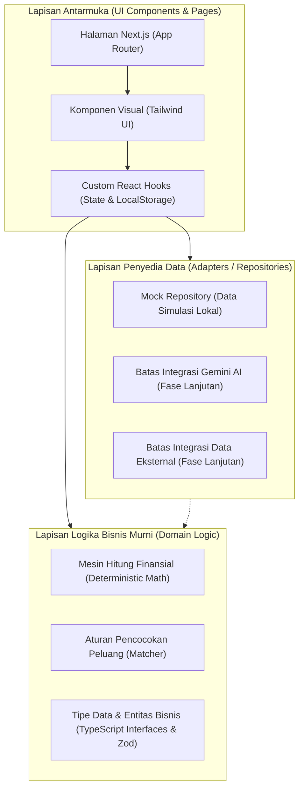

# SPECS/DESIGN.MD — Desain Arsitektur & Spesifikasi Teknis

**Nama Produk**: Usaha Qita — powered by BRI  
**Versi Dokumen**: 1.1.0 (Hasil Audit Sinkronisasi)  
**Status**: Telah Disinkronkan & Siap Sebagai Acuan Pengujian  

---

## 1. Filosofi Arsitektur & Panduan Pemula

Untuk menjaga kemudahan pemahaman bagi pengembang pemula sekaligus menjamin kualitas standar industri, aplikasi ini mengadopsi pola **Clean / Modular Architecture** yang memisahkan kode menjadi lapisan-lapisan yang mandiri:



> [!NOTE]
> **Mengapa Struktur Ini Bagus untuk Pemula?**
> Jika kita mencampur rumus matematika keuangan di dalam tombol atau form React, saat ada rumus yang keliru, kita harus membongkar seluruh kode tampilan. Dengan memisahkan rumus ke dalam fungsi murni (`domain/financial/`), kita dapat menguji hitungan omzet dan BEP secara terpisah 100% tanpa menyentuh tampilan.

---

## 2. Struktur Direktori Proyek (Next.js App Router)

Proyek akan diorganisasi dengan tata letak direktori berikut:

```text
usaha-qita/
├── AGENTS.md                  # Panduan AI & aturan kerja proyek
├── specs/                     # Dokumen spesifikasi SDD
│   ├── requirements.md
│   ├── design.md
│   ├── tasks.md
│   └── acceptance-criteria.md
├── src/
│   ├── app/                   # Next.js App Router (Halaman & Layout)
│   │   ├── layout.tsx         # Root layout (Header, Footer, Disclaimer)
│   │   ├── page.tsx           # Landing Page
│   │   ├── onboarding/        # Alur profil pengguna
│   │   │   └── page.tsx
│   │   ├── dashboard/         # Dashboard ringkasan rencana usaha
│   │   │   └── page.tsx
│   │   ├── opportunities/     # Katalog peluang usaha
│   │   │   ├── page.tsx
│   │   │   └── [id]/page.tsx  # Detail peluang usaha
│   │   ├── calculator/        # Simulator finansial & kalkulator BEP
│   │   │   └── page.tsx
│   │   ├── roadmap/           # Panduan langkah eksekusi usaha
│   │   │   └── page.tsx
│   │   ├── consultation/      # Pengajuan konsultasi Mantri BRI
│   │   │   └── page.tsx
│   │   ├── not-found.tsx      # Tampilan 404 ramah pengguna
│   │   └── error.tsx          # Penanganan error global
│   ├── components/            # Komponen UI Reusable
│   │   ├── ui/                # Primitif UI (Button, Card, Input, Badge, Skeleton, Modal)
│   │   ├── layout/            # Navbar, MobileDrawer, Footer, DisclaimerBanner
│   │   ├── onboarding/        # Komponen langkah onboarding
│   │   ├── opportunities/     # Kartu peluang, filter bar, tag simulasi
│   │   ├── calculator/        # Form asumsi, indikator kesehatan, ringkasan BEP
│   │   ├── roadmap/           # Timeline fase, kartu checklist, modal edukasi
│   │   └── consultation/      # Form konsultasi, consent box, tiket konfirmasi
│   ├── domain/                # Logika bisnis inti (Pure TypeScript)
│   │   ├── financial/         # Kalkulasi omzet, HPP, laba, BEP, payback
│   │   │   ├── calculations.ts
│   │   │   └── calculations.test.ts
│   │   └── opportunities/     # Filter dan pencocokan rekomendasi
│   │       ├── matcher.ts
│   │       └── matcher.test.ts
│   ├── adapters/              # Penyedia data & simulasi eksternal
│   │   ├── mock-data/         # Dataset peluang UMKM berlabel simulasi
│   │   │   └── business-catalog.ts
│   │   └── repositories/      # Repository interface & mock implementation
│   │       ├── opportunity.repository.ts
│   │       └── consultation.repository.ts
│   ├── hooks/                 # React Hooks untuk state & storage
│   │   ├── use-user-profile.ts
│   │   ├── use-financial-calculator.ts
│   │   └── use-roadmap-progress.ts
│   ├── types/                 # Definisi tipe global TypeScript
│   │   ├── profile.ts
│   │   ├── opportunity.ts
│   │   ├── financial.ts
│   │   ├── roadmap.ts
│   │   └── consultation.ts
│   └── lib/                   # Fungsi utilitas (Format Rupiah, Safe Storage)
│       ├── formatters.ts
│       └── safe-storage.ts    # Fallback aman jika localStorage disabled/penuh
├── public/                    # Aset statis (ikon, ilustrasi lokal)
├── .env.example               # Template environment variable (Zero secret)
├── .gitignore                 # Proteksi secret agar .env tidak tercommit
├── tailwind.config.ts         # Konfigurasi tema warna & breakpoint
├── tsconfig.json              # Konfigurasi TypeScript strict
└── package.json               # Dependensi proyek
```

---

## 3. Desain Model Data, Skema Validasi & Kontrak TypeScript

Untuk menjamin keamanan dan integritas data input pengguna, aplikasi menggunakan TypeScript strict didukung oleh skema validasi runtime (misal: **Zod**).

### 3.1 Model Profil Pengguna (`types/profile.ts`)
```typescript
export type BusinessGoal = 'start_new' | 'grow_existing' | 'expand_region';
export type ExperienceLevel = 'beginner' | 'intermediate' | 'advanced';
export type BusinessCategory = 'culinary' | 'retail' | 'services' | 'agribusiness' | 'creative';

export interface UserProfile {
  id: string;
  fullName: string;
  goal: BusinessGoal;
  availableCapital: number; // Dalam Rupiah, minimal Rp 500.000
  location: {
    province: string;
    regency: string; // Kota/Kabupaten
    district?: string; // Kecamatan (opsional)
  };
  experience: ExperienceLevel;
  preferredCategories: BusinessCategory[];
  updatedAt: string; // ISO Date String
}
```

### 3.2 Skema Validasi Runtime (Zod) untuk Form & Keamanan Data
```typescript
// Contoh skema validasi profil di src/domain/validation/profile.schema.ts
import { z } from 'zod';

export const userProfileSchema = z.object({
  fullName: z.string().trim().min(3, 'Nama lengkap minimal 3 karakter'),
  goal: z.enum(['start_new', 'grow_existing', 'expand_region']),
  availableCapital: z.number().min(500000, 'Modal awal minimal Rp 500.000 untuk simulasi yang realistis'),
  location: z.object({
    province: z.string().min(1, 'Provinsi wajib dipilih'),
    regency: z.string().min(1, 'Kota/Kabupaten wajib dipilih'),
    district: z.string().optional(),
  }),
  experience: z.enum(['beginner', 'intermediate', 'advanced']),
  preferredCategories: z.array(z.string()).min(1, 'Pilih minimal 1 kategori usaha yang menarik minat Anda'),
});

// Skema validasi formulir konsultasi Mantri BRI (src/domain/validation/consultation.schema.ts)
export const consultationRequestSchema = z.object({
  fullName: z.string().trim().min(3, 'Nama lengkap minimal 3 karakter'),
  phoneNumber: z
    .string()
    .trim()
    .regex(/^(\+62|62|0)8[1-9][0-9]{6,10}$/, 'Nomor WhatsApp tidak valid (contoh: 081234567890)'),
  preferredLocation: z.string().trim().min(3, 'Lokasi unit kerja wajib diisi'),
  businessTopic: z.enum(['financial_literacy', 'cashflow_management', 'business_expansion', 'general_advice']),
  notes: z.string().max(500, 'Catatan tambahan maksimal 500 karakter').optional(),
  explicitConsentGiven: z.literal(true, {
    errorMap: () => ({ message: 'Anda wajib menyetujui pembagian profil untuk konsultasi' }),
  }),
  disclaimerAcknowledged: z.literal(true, {
    errorMap: () => ({ message: 'Anda wajib memahami konsultasi ini bukan jaminan kredit' }),
  }),
});

// Skema validasi asumsi finansial (src/domain/validation/financial.schema.ts)
export const financialInputSchema = z.object({
  sellingPricePerUnit: z.number().positive('Harga jual harus lebih besar dari 0'),
  unitsSoldPerDay: z.number().min(0, 'Volume penjualan tidak boleh negatif'),
  operatingDaysPerMonth: z.number().int().min(1).max(31, 'Hari operasional antara 1 - 31 hari'),
  variableCostPerUnit: z.number().min(0, 'Biaya variabel tidak boleh negatif'),
  monthlyFixedCosts: z.object({
    rent: z.number().min(0),
    labor: z.number().min(0),
    utilities: z.number().min(0),
    marketingAndOther: z.number().min(0),
  }),
  initialInvestment: z.number().min(0, 'Modal investasi awal tidak boleh negatif'),
});
```

### 3.3 Model Peluang Bisnis (`types/opportunity.ts`)
```typescript
import { BusinessCategory } from './profile';

export type RiskLevel = 'low' | 'medium' | 'high';

export interface BusinessOpportunity {
  id: string;
  slug: string;
  title: string;
  category: BusinessCategory;
  shortDescription: string;
  fullDescription: string;
  minCapital: number;
  maxCapital: number;
  matchingRationale: string;
  targetCustomer: string;
  riskLevel: RiskLevel;
  riskMitigationTips: string[];
  defaultFinancialAssumptions: {
    sellingPricePerUnit: number;
    estimatedUnitsSoldPerDay: number;
    operatingDaysPerMonth: number;
    variableCostPerUnit: number;
    monthlyRent: number;
    monthlyLaborCost: number;
    monthlyUtilitiesCost: number;
    monthlyOtherFixedCost: number;
    initialInvestmentCapital: number;
  };
  isSimulation: true; // Wajib true pada tahap MVP
  dataSourceLabel: string; // Contoh: "Estimasi Model Edukatif Usaha Qita (Data Simulasi)"
}
```

### 3.4 Model Input & Output Finansial (`types/financial.ts`)
```typescript
export interface FinancialInput {
  sellingPricePerUnit: number; // Harga jual per satuan produk/jasa
  unitsSoldPerDay: number; // Rata-rata transaksi/unit per hari
  operatingDaysPerMonth: number; // Misal 26 hari (libur hari minggu) atau 30 hari
  variableCostPerUnit: number; // Biaya variabel per unit (Bahan baku / HPP)
  monthlyFixedCosts: {
    rent: number; // Sewa tempat/lapak
    labor: number; // Gaji karyawan/asisten
    utilities: number; // Listrik, air, gas, internet
    marketingAndOther: number; // Biaya kebersihan, iuran, promosi
  };
  initialInvestment: number; // Total modal awal (beli alat, renovasi ringan)
}

export type FinancialHealthStatus = 'healthy_profit' | 'narrow_margin' | 'operating_loss';

export interface FinancialResult {
  monthlyRevenue: number; // Omzet bulanan (IDR)
  monthlyVariableCost: number; // Total biaya bahan baku sebulan (IDR)
  monthlyFixedCost: number; // Total biaya tetap sebulan (IDR)
  totalMonthlyCost: number; // Biaya operasional total sebulan (IDR)
  monthlyNetProfit: number; // Laba bersih sebelum pajak (IDR)
  profitMarginPercent: number; // Margin laba bersih (%)
  contributionMarginPerUnit: number; // Laba kotor per unit produk (IDR)
  contributionMarginRatio: number; // Rasio margin kontribusi (0 - 1)
  bepUnitsMonthly: number | null; // Titik impas (unit per bulan), null jika CM <= 0
  bepRevenueMonthly: number | null; // Titik impas (Rupiah per bulan), null jika CM <= 0
  paybackPeriodMonths: number | null; // Estimasi balik modal (bulan), null jika rugi
  healthStatus: FinancialHealthStatus;
  statusMessage: string;
}
```

### 3.5 Model Roadmap Usaha (`types/roadmap.ts`)
```typescript
export interface RoadmapStep {
  id: string;
  phase: 'planning' | 'legality' | 'operations' | 'marketing';
  title: string;
  description: string;
  educationalTip: string;
  actionUrl?: string; // Misal tautan ke panduan OSS untuk NIB
  isCrucialForMicroBusiness: boolean;
}

export interface RoadmapProgressState {
  completedStepIds: string[];
  lastUpdated: string;
}
```

### 3.6 Model Konsultasi Mantri BRI (`types/consultation.ts`)
```typescript
export interface ConsultationRequest {
  id: string;
  referenceNumber: string; // Contoh: "UQ-MNT-202610-8472"
  fullName: string;
  phoneNumber: string; // Nomor WA aktif (format Indonesia, e.g. 0812xxxxxxx)
  preferredLocation: string; // Alamat/Kecamatan unit kerja terdekat
  businessTopic: 'financial_literacy' | 'cashflow_management' | 'business_expansion' | 'general_advice';
  businessProfileSnapshot: {
    category: string;
    plannedCapital: number;
    projectedNetProfit: number;
  };
  notes?: string;
  explicitConsentGiven: boolean; // Wajib true
  disclaimerAcknowledged: boolean; // Wajib true
  submittedAt: string;
  status: 'simulation_sent';
}
```

---

## 4. Mesin Hitung Finansial Deterministik (Spesifikasi Rumus Matematika)

Seluruh logika hitung disimpan dalam modul murni `src/domain/financial/calculations.ts`.

### 4.1 Rumus Matematika Inti

1. **Omzet Bulanan (Monthly Revenue - $R$)**:
   $$\text{Total Unit Terjual Sebulan } (Q) = \text{unitsSoldPerDay} \times \text{operatingDaysPerMonth}$$
   $$R = Q \times \text{sellingPricePerUnit}$$

2. **Total Biaya Variabel Bulanan ($VC$)**:
   $$VC = Q \times \text{variableCostPerUnit}$$

3. **Margin Kontribusi per Unit ($CM$)**:
   $$CM = \text{sellingPricePerUnit} - \text{variableCostPerUnit}$$
   *Aturan Khusus*: Jika $CM \le 0$, harga jual tidak mampu menutup modal bahan baku langsung. Sistem menandai ini sebagai risiko kritis dan menetapkan BEP tidak dapat dicapai.

4. **Rasio Margin Kontribusi ($CMR$)**:
   $$CMR = \begin{cases} \frac{CM}{\text{sellingPricePerUnit}}, & \text{jika } \text{sellingPricePerUnit} > 0 \\ 0, & \text{lainnya} \end{cases}$$

5. **Total Biaya Tetap Bulanan ($FC$)**:
   $$FC = \text{rent} + \text{labor} + \text{utilities} + \text{marketingAndOther}$$

6. **Total Biaya Pengeluaran Bulanan ($TC$)**:
   $$TC = VC + FC$$

7. **Laba Bersih Bulanan ($NP$)**:
   $$NP = R - TC = (Q \times CM) - FC$$

8. **Margin Laba Bersih ($PM$)**:
   $$PM = \begin{cases} \left(\frac{NP}{R}\right) \times 100\%, & \text{jika } R > 0 \\ 0\%, & \text{lainnya} \end{cases}$$

9. **Titik Impas dalam Satuan Unit ($BEP_{\text{unit}}$)**:
   $$BEP_{\text{unit}} = \begin{cases} \left\lceil \frac{FC}{CM} \right\rceil, & \text{jika } CM > 0 \\ \text{null (Tidak dapat dicapai)}, & \text{jika } CM \le 0 \end{cases}$$

10. **Titik Impas dalam Nilai Rupiah ($BEP_{\text{Rupiah}}$)**:
    $$BEP_{\text{Rupiah}} = \begin{cases} \text{round}\left( \frac{FC}{CMR} \right), & \text{jika } CMR > 0 \\ \text{null (Tidak dapat dicapai)}, & \text{jika } CMR \le 0 \end{cases}$$

11. **Estimasi Periode Balik Modal ($PP$ - Payback Period dalam Bulan)**:
    $$PP = \begin{cases} \text{round}\left( \frac{\text{initialInvestment}}{NP}, 1 \text{ desimal} \right), & \text{jika } NP > 0 \\ \text{null (Tidak balik modal / defisit)}, & \text{jika } NP \le 0 \end{cases}$$

### 4.2 Klasifikasi Kesehatan Keuangan Bisnis

- **Hijau (`healthy_profit`)**: $NP > 0$ dan $PM \ge 15\%$. Bisnis memiliki bantalan keamanan keuntungan yang cukup.
- **Kuning (`narrow_margin`)**: $NP > 0$ tetapi $PM < 15\%$. Bisnis mencatat untung namun rentan rugi bila terjadi kenaikan harga bahan baku atau sewa.
- **Merah (`operating_loss`)**: $NP \le 0$. Bisnis mengalami kerugian operasional; pengguna disarankan meninjau ulang harga jual atau memangkas biaya tetap.

---

## 5. Arsitektur Repository Mock, Keamanan & Penyimpanan Lokal

### 5.1 Interface Repository (Ports)
```typescript
// src/adapters/repositories/opportunity.repository.ts
import { BusinessOpportunity } from '@/types/opportunity';
import { UserProfile } from '@/types/profile';

export interface IOpportunityRepository {
  getAll(): Promise<BusinessOpportunity[]>;
  getById(id: string): Promise<BusinessOpportunity | null>;
  getRecommendedForProfile(profile: UserProfile): Promise<BusinessOpportunity[]>;
}
```

### 5.2 Implementasi Mock (`MockOpportunityRepository`)
- Membaca dataset terstruktur dari `src/adapters/mock-data/business-catalog.ts`.
- Menerapkan simulasi jeda buatan (*artificial delay* 300ms) untuk menguji *loading state* UI secara realistis.
- Menyediakan penanda flag metadata bahwa data bersumber dari simulasi edukatif (`isSimulation: true`).

### 5.3 Modul Penyimpanan Lokal Aman (`src/lib/safe-storage.ts`)
Untuk mengantisipasi browser dalam mode penyamaran (*Safari Private Browsing*) atau kondisi memori peramban penuh (`QuotaExceededError`), seluruh pembacaan/penulisan storage dibungkus utilitas aman dengan fallback memori:

```typescript
// Konsep implementasi safeStorage
const memoryStore = new Map<string, string>();

export const safeStorage = {
  getItem: (key: string): string | null => {
    try {
      return localStorage.getItem(key);
    } catch {
      return memoryStore.get(key) || null;
    }
  },
  setItem: (key: string, value: string): void => {
    try {
      localStorage.setItem(key, value);
    } catch {
      memoryStore.set(key, value);
    }
  },
};
```

### 5.4 Batas Integrasi Masa Depan (Future Integration Boundaries)
- **Gemini API Adapter**: Disediakan interface `IAIService` dengan method `generateSWOTAnalysis(profile, financial)` yang diisolasi di folder `src/adapters/ai/`. Pada tahap MVP, implementasinya mengembalikan mock respon edukatif.
- **Data BPS / Potensi Daerah**: Disediakan interface `IMarketDataProvider` yang mengembalikan indikator densitas penduduk simulasi.
- **BRI Consultation Service**: Disediakan interface `IConsultationService` yang saat ini mencatat log simulasi ke browser storage dan membuat nomor referensi tiket unik.

---

## 6. Desain Antarmuka & Responsivitas (Design System)

### 6.1 Palet Warna Tematik
- **Primary Navy (Kepercayaan & Stabilitas Finansial)**:
  - `brand-navy-900`: `#0B2A4A` (Background header, teks heading utama)
  - `brand-navy-600`: `#00529C` (Warna aksen utama BRI, tombol primer)
  - `brand-navy-50`: `#EBF3FA` (Latar belakang seksi hero & highlight)
- **Secondary Emerald (Kesehatan Finansial & Pertumbuhan)**:
  - `brand-emerald-600`: `#059669` (Indikator laba sehat, badge berhasil)
  - `brand-emerald-50`: `#ECFDF5` (Latar kartu indikator sehat)
- **Warning Amber (Waspada Margin Tipis)**:
  - `brand-amber-600`: `#D97706`
  - `brand-amber-50`: `#FFFBEB`
- **Danger Coral (Defisit / Risiko Tinggi)**:
  - `brand-danger-600`: `#DC2626`
  - `brand-danger-50`: `#FEF2F2`
- **Neutral Grays**: Slate 50 s/d Slate 900 untuk tipografi yang nyaman dibaca.

### 6.2 Standar Breakpoint & Pengujian Layar
- **360px** (Layar ponsel Android kompak, misal: Galaxy A series lama):
  - Form input single column.
  - Tabel kalkulator diubah menjadi susunan kartu vertikal (*stacked summary cards*).
  - Target sentuh (*touch target*) minimal 44x44px.
- **390px** (Layar ponsel modern standar, misal: iPhone 13/14/15/16):
  - Padding samping seimbang (16px), tombol CTA (*Call To Action*) memenuhi lebar bawah.
- **768px** (Tablet / iPad Mini):
  - Grid 2 kolom untuk kartu peluang usaha dan simulasi input-output berdampingan.
- **1440px** (Desktop Monitor):
  - Tampilan kalkulator interaktif dua kolom: Asumsi di sisi kiri, visualisasi hasil & grafik BEP di sisi kanan dengan posisi *sticky*.

---

## 7. Penanganan State (Form, Loading, Empty, Error)

Setiap modul utama wajib memiliki komponen terstandarisasi untuk 4 kondisi:
1. **Default / Ready State**: Tampilan form atau data aktif dengan teks bantuan kontekstual.
2. **Loading Skeleton State**: Skeleton beranimasi pulsa (*pulse animation*) dengan proporsi ukuran sama dengan kartu data sebenarnya untuk menghindari lonjakan tata letak (*layout shift*).
3. **Empty State**: Tampilan bila data belum ada (misal: "Belum ada rencana usaha tersimpan", dilengkapi tombol ajakan "Mulai Isi Profil").
4. **Error State**: Banner peringatan ramah pengguna dengan tombol aksi coba lagi (*retry button*) dan penjelasan masalah tanpa menampilkan pesan teknis yang membingungkan.
