# SPECS/TASKS.MD — Rencana Kerja & Rincian Tugas (Work Breakdown Structure)

**Nama Produk**: Usaha Qita — powered by BRI  
**Versi Dokumen**: 1.1.0 (Hasil Audit Sinkronisasi)  
**Status**: Telah Disinkronkan & Siap Sebagai Acuan Eksekusi  

---

## 1. Panduan Pembacaan & Keterlacakan (Traceability)

Setiap tugas pada dokumen ini memiliki:
- **Task ID**: Pengenal unik stabil untuk melacak progres pengerjaan (contoh: `TASK-FIN-01`).
- **Target Requirements**: Tautan ke Requirement ID di `specs/requirements.md`.
- **Target Acceptance Criteria**: Tautan ke Acceptance Criteria ID di `specs/acceptance-criteria.md`.
- **Kompleksitas**: Ukuran usaha estimasi (S: Kecil, M: Sedang, L: Kompleks).
- **Dependensi**: Tugas yang harus diselesaikan terlebih dahulu.

---

## 2. Fase Pengerjaan Proyek

```mermaid
flowchart LR
    P0["Fase 0: Inisialisasi & Setup"] --> P1["Fase 1: Domain Engine Finansial"]
    P1 --> P2["Fase 2: Mock Repository"]
    P2 --> P3["Fase 3: Layout & Shell UI"]
    P3 --> P4["Fase 4: Onboarding Profil"]
    P4 --> P5["Fase 5: Peluang Usaha"]
    P5 --> P6["Fase 6: Simulator & BEP"]
    P6 --> P7["Fase 7: Roadmap Usaha"]
    P7 --> P8["Fase 8: Konsultasi Mantri"]
    P8 --> P9["Fase 9: QA & Dokumentasi"]
```

---

## 3. Rincian Tugas Terperinci (Task Breakdown)

### Fase 0: Inisialisasi Proyek, Konfigurasi & Alat Pengembangan (Setup)

| Task ID | Nama Tugas | Requirement Terkait | AC Terkait | Kompleksitas | Dependensi |
|---|---|---|---|---|---|
| `TASK-SETUP-01` | Inisialisasi Next.js App Router dengan TypeScript Strict Mode, Tailwind CSS, dan konfigurasi `.gitignore` ketat (secara eksplisit mengecualikan `node_modules/`, `.next/`, `.env*`, dan tetap mengizinkan `.env.example` via aturan negasi `!.env.example`) | `REQ-SYS-01` | `AC-SYS-01.1` | S | Tidak ada |
| `TASK-SETUP-02` | Konfigurasi Linter (ESLint), Formatter, dan Test Runner (`vitest`) | `REQ-SYS-01` | - | S | `TASK-SETUP-01` |
| `TASK-SETUP-03` | Pembuatan file `.env.example` (Zero Secret) dan dokumentasi instruksi instalasi awal, memastikan file rahasia `.env*` tidak pernah tercommit | `REQ-SYS-03` | - | S | `TASK-SETUP-01` |

### Fase 1: Domain Engine Finansial & Tes Otomatis (Pure TypeScript)

| Task ID | Nama Tugas | Requirement Terkait | AC Terkait | Kompleksitas | Dependensi |
|---|---|---|---|---|---|
| `TASK-CORE-01` | Deklarasi kontrak tipe data TypeScript (`profile.ts`, `financial.ts`, `opportunity.ts`, `roadmap.ts`, `consultation.ts`) dan skema validasi runtime Zod | `REQ-PROF-01`, `REQ-FIN-01`, `REQ-OPP-01` | `AC-FIN-02.1` | S | `TASK-SETUP-01` |
| `TASK-CORE-02` | Implementasi rumus deterministik finansial (Omzet, Biaya, Laba, Margin, BEP Unit, BEP Rupiah, Payback Period) di `src/domain/financial/calculations.ts` | `REQ-FIN-02`, `REQ-FIN-03`, `REQ-FIN-04`, `REQ-FIN-05` | `AC-FIN-02.1`, `AC-FIN-02.2`, `AC-FIN-02.3`, `AC-FIN-03.1`, `AC-FIN-04.1`, `AC-FIN-05.1` | M | `TASK-CORE-01` |
| `TASK-CORE-03` | Penulisan Unit Test komprehensif untuk mesin hitung finansial (`src/domain/financial/calculations.test.ts`) menggunakan seluruh vektor uji AC | `REQ-FIN-02`, `REQ-FIN-03`, `REQ-FIN-04`, `REQ-FIN-05` | `AC-FIN-02.1`, `AC-FIN-02.2`, `AC-FIN-02.3`, `AC-FIN-03.1`, `AC-FIN-04.1`, `AC-FIN-05.1` | M | `TASK-CORE-02` |
| `TASK-CORE-04` | Implementasi fungsi utilitas pemformatan angka Rupiah (`formatters.ts`) dan modul penyimpanan lokal aman (`safe-storage.ts`) yang menangani kegagalan `localStorage` tanpa crash dengan fallback in-memory state sementara | `REQ-FIN-01`, `REQ-PROF-03` | `AC-FIN-02.1`, `AC-PROF-03.1` | S | `TASK-CORE-01` |

### Fase 2: Mock Repository Layer & Dataset Simulasi UMKM

| Task ID | Nama Tugas | Requirement Terkait | AC Terkait | Kompleksitas | Dependensi |
|---|---|---|---|---|---|
| `TASK-DATA-01` | Pembuatan dataset simulasi kurasi UMKM Indonesia (Kuliner, Ritel, Jasa, Agribisnis, Kreatif) dengan asumsi finansial bawaan | `REQ-OPP-01`, `REQ-OPP-02`, `REQ-DATA-02` | `AC-OPP-01.1`, `AC-OPP-02.1`, `AC-SYS-03.2`, `AC-DATA-02.1` | M | `TASK-CORE-01` |
| `TASK-DATA-02` | Implementasi `MockOpportunityRepository` dengan simulasi latensi, pemisahan antarmuka (ports), dan penanda metadata `isSimulation: true` | `REQ-DATA-01`, `REQ-DATA-02` | `AC-SYS-03.2`, `AC-DATA-01.1`, `AC-DATA-02.1` | S | `TASK-DATA-01` |
| `TASK-DATA-03` | Implementasi algoritma pencocokan rekomendasi berdasarkan modal dan minat pengguna (`src/domain/opportunities/matcher.ts`) | `REQ-OPP-01` | `AC-OPP-01.1` | M | `TASK-DATA-01` |

### Fase 3: Primitif UI, Layout Shell & Kepatuhan Etis (Mobile-First)

| Task ID | Nama Tugas | Requirement Terkait | AC Terkait | Kompleksitas | Dependensi |
|---|---|---|---|---|---|
| `TASK-UI-01` | Konfigurasi tema warna Tailwind (Navy BRI, Emerald Health, Amber Warning, Neutral Slates) | `REQ-SYS-01` | `AC-SYS-01.1` | S | `TASK-SETUP-01` |
| `TASK-UI-02` | Komponen primitif UI (Button, Card, InputField, SelectDropdown, Badge, Modal, SkeletonLoader) | `REQ-SYS-01`, `REQ-SYS-02` | `AC-SYS-02.1` | M | `TASK-UI-01` |
| `TASK-UI-03` | Komponen Navigasi Utama (Navbar responsif dengan mobile drawer untuk layar < 768px) | `REQ-SYS-04`, `REQ-SYS-01` | `AC-SYS-01.1`, `AC-SYS-04.1` | M | `TASK-UI-02` |
| `TASK-UI-04` | Komponen Footer Kepatuhan & Etis dengan teks disclaimer resmi dan transparansi simulasi | `REQ-SYS-03` | `AC-SYS-03.1` | S | `TASK-UI-02` |
| `TASK-UI-05` | Halaman Landing Page (`src/app/page.tsx`) dengan sajian nilai manfaat, preview fitur, dan CTA awal | `REQ-SYS-04`, `REQ-SYS-03` | `AC-SYS-01.1`, `AC-SYS-03.1` | M | `TASK-UI-03`, `TASK-UI-04` |

### Fase 4: Onboarding Profil Pengguna & Persistensi Lokal

| Task ID | Nama Tugas | Requirement Terkait | AC Terkait | Kompleksitas | Dependensi |
|---|---|---|---|---|---|
| `TASK-PROF-01` | Custom Hook `useUserProfile` menggunakan `safeStorage` untuk sinkronisasi profil browser | `REQ-PROF-03` | `AC-PROF-03.1` | S | `TASK-CORE-04` |
| `TASK-PROF-02` | Komponen formulir multi-step Onboarding (`/onboarding`) mencakup Tujuan, Modal, Lokasi, Pengalaman, dan Kategori Minat dengan validasi runtime Zod (`userProfileSchema`) | `REQ-PROF-01`, `REQ-PROF-02` | `AC-PROF-01.1`, `AC-PROF-02.1`, `AC-PROF-02.2` | L | `TASK-PROF-01`, `TASK-UI-02` |
| `TASK-PROF-03` | Halaman Dashboard Pengguna (`/dashboard`) yang menampilkan ikhtisar profil aktif dan status rencana usaha | `REQ-SYS-04`, `REQ-PROF-03` | `AC-PROF-03.1`, `AC-SYS-04.1` | M | `TASK-PROF-02` |

### Fase 5: Katalog & Rekomendasi Peluang Usaha

| Task ID | Nama Tugas | Requirement Terkait | AC Terkait | Kompleksitas | Dependensi |
|---|---|---|---|---|---|
| `TASK-OPP-01` | Komponen Kartu Peluang Usaha (`OpportunityCard`) dengan badge "Data simulasi", modal, risiko, dan target pasar | `REQ-OPP-02`, `REQ-DATA-02` | `AC-OPP-02.1`, `AC-SYS-03.2`, `AC-DATA-02.1` | M | `TASK-UI-02`, `TASK-DATA-01` |
| `TASK-OPP-02` | Halaman Katalog Rekomendasi (`/opportunities`) dengan filter kategori, rentang modal, dan status loading/empty | `REQ-OPP-01`, `REQ-OPP-04`, `REQ-SYS-02` | `AC-OPP-01.1`, `AC-OPP-04.1`, `AC-SYS-02.1` | L | `TASK-OPP-01`, `TASK-DATA-03` |
| `TASK-OPP-03` | Halaman Detail Peluang Usaha (`/opportunities/[id]`) dengan visualisasi potensi dan tombol transfer ke kalkulator | `REQ-OPP-02`, `REQ-OPP-03` | `AC-OPP-02.1`, `AC-OPP-03.1` | M | `TASK-OPP-01` |

### Fase 6: Simulator Finansial Interaktif & Kalkulator BEP

| Task ID | Nama Tugas | Requirement Terkait | AC Terkait | Kompleksitas | Dependensi |
|---|---|---|---|---|---|
| `TASK-FIN-01` | Custom Hook `useFinancialCalculator` untuk mengelola input dinamis dan memicu fungsi hitung deterministik secara reaktif | `REQ-FIN-01`, `REQ-FIN-02` | `AC-FIN-01.1`, `AC-FIN-02.1` | M | `TASK-CORE-02`, `TASK-CORE-03` |
| `TASK-FIN-02` | Komponen Form Input Asumsi Finansial (Harga Jual, Volume Harian, HPP per unit, Komponen Biaya Tetap, Modal Awal) dengan validasi runtime Zod (`financialInputSchema`) | `REQ-FIN-01` | `AC-FIN-01.1` | M | `TASK-FIN-01`, `TASK-UI-02` |
| `TASK-FIN-03` | Komponen Kartu Hasil Perhitungan & Indikator Status Kesehatan Finansial (Hijau, Kuning, Merah) | `REQ-FIN-02`, `REQ-FIN-05` | `AC-FIN-02.1`, `AC-FIN-02.2`, `AC-FIN-02.3`, `AC-FIN-05.1` | M | `TASK-FIN-01` |
| `TASK-FIN-04` | Komponen Visualisasi Titik Impas (BEP Card) dalam satuan Unit dan Rupiah serta estimasi waktu balik modal (termasuk penanganan rugi) | `REQ-FIN-03`, `REQ-FIN-04` | `AC-FIN-03.1`, `AC-FIN-04.1` | M | `TASK-FIN-01` |
| `TASK-FIN-05` | Halaman Lengkap Simulator (`/calculator`) yang memadukan input asumsi dan panel ringkasan (responsif 360px s/d 1440px) | `REQ-FIN-01`, `REQ-SYS-01` | `AC-SYS-01.1`, `AC-SYS-01.3` | L | `TASK-FIN-02`, `TASK-FIN-03`, `TASK-FIN-04` |

### Fase 7: Roadmap Usaha Bertahap & Checklist Interaktif

| Task ID | Nama Tugas | Requirement Terkait | AC Terkait | Kompleksitas | Dependensi |
|---|---|---|---|---|---|
| `TASK-ROAD-01` | Dataset tahapan roadmap standar UMKM (Perencanaan, Legalitas NIB/OSS, Pengadaan, Peluncuran) | `REQ-ROAD-01`, `REQ-ROAD-03` | `AC-ROAD-01.1`, `AC-ROAD-03.1` | S | `TASK-CORE-01` |
| `TASK-ROAD-02` | Custom Hook `useRoadmapProgress` menggunakan `safeStorage` untuk menyimpan checklist | `REQ-ROAD-02` | `AC-ROAD-02.1` | S | `TASK-ROAD-01`, `TASK-CORE-04` |
| `TASK-ROAD-03` | Komponen Timeline Fase & Kartu Checklist Langkah dengan modal tips edukasi panduan praktis | `REQ-ROAD-01`, `REQ-ROAD-02`, `REQ-ROAD-03` | `AC-ROAD-01.1`, `AC-ROAD-02.1`, `AC-ROAD-03.1` | M | `TASK-ROAD-02`, `TASK-UI-02` |
| `TASK-ROAD-04` | Halaman Roadmap Lengkap (`/roadmap`) dengan progress bar persentase penyelesaian | `REQ-ROAD-01`, `REQ-ROAD-02` | `AC-ROAD-01.1`, `AC-ROAD-02.1` | M | `TASK-ROAD-03` |

### Fase 8: Alur Konsultasi Mantri BRI (Transparan & Berbasis Persetujuan)

| Task ID | Nama Tugas | Requirement Terkait | AC Terkait | Kompleksitas | Dependensi |
|---|---|---|---|---|---|
| `TASK-MNT-01` | Komponen Form Pengajuan Konsultasi dengan validasi runtime Zod (`consultationRequestSchema`) untuk kontak WA dan ringkasan usaha | `REQ-MANTRI-01` | `AC-MANTRI-01.1` | M | `TASK-UI-02`, `TASK-PROF-01` |
| `TASK-MNT-02` | Komponen Kotak Persetujuan Eksplisit (*Consent Checkbox*) dan penegakan tombol disabled | `REQ-MANTRI-02`, `REQ-SYS-03` | `AC-MANTRI-02.1`, `AC-SYS-03.1` | S | `TASK-MNT-01` |
| `TASK-MNT-03` | Komponen Tiket Konfirmasi Simulasi Digital (`SimulationTicketCard`) dengan nomor referensi unik | `REQ-MANTRI-03` | `AC-MANTRI-03.1` | M | `TASK-MNT-01` |
| `TASK-MNT-04` | Halaman Konsultasi Lengkap (`/consultation`) memadukan form, consent box, dan alur tiket | `REQ-MANTRI-01`, `REQ-MANTRI-02`, `REQ-MANTRI-03` | `AC-MANTRI-01.1`, `AC-MANTRI-02.1`, `AC-MANTRI-03.1` | M | `TASK-MNT-01`, `TASK-MNT-02`, `TASK-MNT-03` |

### Fase 9: Pengujian Kualitas (QA), Verifikasi Viewport & Dokumentasi

| Task ID | Nama Tugas | Requirement Terkait | AC Terkait | Kompleksitas | Dependensi |
|---|---|---|---|---|---|
| `TASK-QA-01` | Eksekusi seluruh pengujian otomatis unit test (perhitungan matematika finansial & matcher) | `REQ-FIN-02`, `REQ-FIN-03`, `REQ-FIN-04`, `REQ-FIN-05` | `AC-FIN-02.1`, `AC-FIN-02.2`, `AC-FIN-02.3`, `AC-FIN-03.1`, `AC-FIN-04.1`, `AC-FIN-05.1` | S | `TASK-CORE-03` |
| `TASK-QA-02` | Pengujian manual lintas viewport (360px, 390px, 768px, 1440px) pada seluruh alur halaman | `REQ-SYS-01`, `REQ-SYS-04` | `AC-SYS-01.1`, `AC-SYS-01.2`, `AC-SYS-01.3`, `AC-SYS-04.1` | M | Seluruh halaman UI selesai |
| `TASK-QA-03` | Verifikasi state antarmuka (empty state, loading skeleton, format error message) | `REQ-SYS-02` | `AC-SYS-02.1`, `AC-OPP-04.1` | S | Seluruh halaman UI selesai |
| `TASK-DOC-01` | Dokumentasi panduan instalasi lokal, perintah pengujian, dan daftar environment variable di `README.md` | `REQ-SYS-01` | - | S | `TASK-QA-02` |

### Fase 10: Batas Integrasi Masa Depan (Post-MVP / Future Extension)

| Task ID | Nama Tugas | Keterangan & Batasan |
|---|---|---|
| `TASK-FUTURE-01` | Integrasi Gemini API untuk analisis SWOT otomatis | Hanya diimplementasikan setelah MVP stabil dan mendapat persetujuan pengguna |
| `TASK-FUTURE-02` | Integrasi Google Places API untuk pencarian kompetitor terdekat | Batas adapter telah disiapkan di `src/adapters/` |
| `TASK-FUTURE-03` | Integrasi Database Cloud (PostgreSQL / Supabase) | Hanya diimplementasikan jika pengguna membutuhkan akun multi-device |

---

## 4. Definisi Selesai (Definition of Done - DoD)

Suatu tugas hanya boleh ditandai selesai jika memenuhi seluruh kriteria berikut:
1. **Lulus Uji Ketat**: Lulus seluruh unit test terkait tanpa error.
2. **Kesesuaian Spesifikasi**: Memenuhi kriteria penerimaan yang tertuang dalam `specs/acceptance-criteria.md`.
3. **Bebas Error Linter & Tipe**: Tidak ada error TypeScript (`tsc --noEmit`) atau peringatan ESLint.
4. **Teruji Multi-Resolusi**: Tampilan rapi dan proporsional pada 360px, 390px, 768px, dan 1440px.
5. **Transparansi Simulasi**: Seluruh data mock telah memiliki label "Data simulasi" yang jelas.
6. **Dokumentasi & Penjelasan**: Logika kode dijelaskan dengan bahasa Indonesia yang mudah dipahami pemula.
